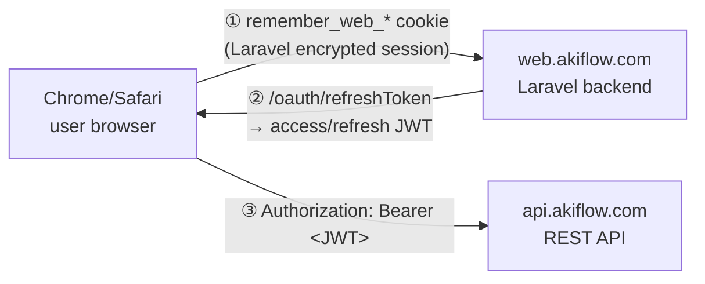
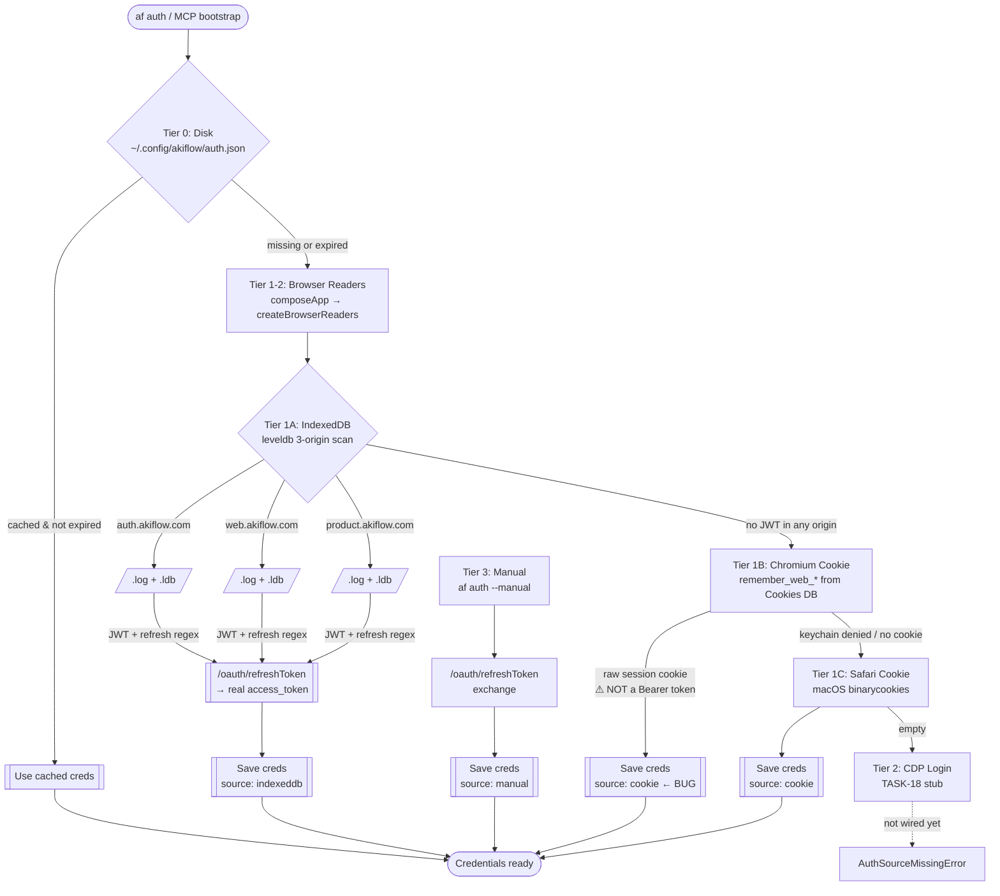
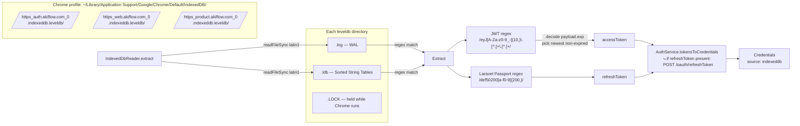
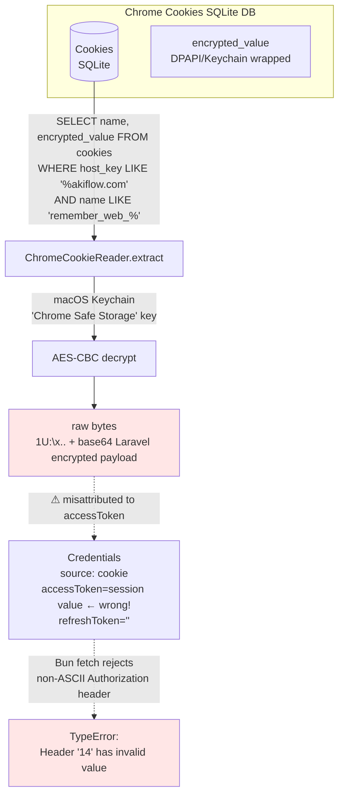
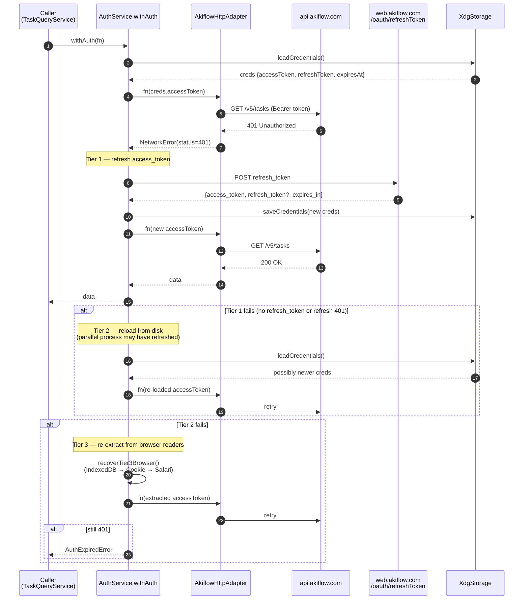

# Akiflow Token Acquisition Flow

[한국어](./akiflow-token-acquisition.md) | **English**

`akiflow-toolkit` is a **reverse-engineered CLI/MCP toolkit**; Akiflow has no official way to issue API tokens. It obtains a Bearer JWT either by extracting a valid token from what the Akiflow web app leaves in Chrome/Safari, or by exchanging a refresh_token the user enters manually. This document walks through that process layer by layer.

Related ADRs:
- **ADR-0003**: 3-tier recovery (disk → browser → CDP)
- **ADR-0006**: Hexagonal architecture (Port-driven)
- **ADR-0011**: Composition root
- **TASK-18**: CDP login wiring (not finished yet)

---

## 1. Akiflow's dual auth scheme

Akiflow runs **two different auth schemes** side by side.



| Scheme | Issuer | Format | Purpose | Stored in |
|--------|--------|--------|---------|-----------|
| **Laravel session cookie** | `web.akiflow.com` backend | `eyJpdiI:...,"value":"...","mac":"..."` (Laravel `encrypt()` output) | Web app SSO / session | `remember_web_*` in Chrome's `Cookies` DB |
| **OAuth Passport token** | `web.akiflow.com/oauth/refreshToken` | `access_token`: 3-part JWT / `refresh_token`: Laravel Passport encrypted hex (`def50200...`) | API Bearer auth | Saved to IndexedDB by the web app SPA |

**Key point**: the REST API (`api.akiflow.com`) always requires a **JWT Bearer**. The session cookie is internal to the Laravel backend; **sending it to the API makes Bun fetch reject it with `TypeError: Header has invalid value`**.

---

## 2. 4-Tier Hierarchical Cascade

`AuthService.authenticate()` tries each tier in order and stops at the first that succeeds.



### Tier order at a glance

| # | Tier | Implementation | source on success |
|---|------|----------------|-------------------|
| 0 | Disk (stored) | `XdgStorage` | keeps the existing value |
| 1A | Chromium IndexedDB | `IndexedDbReader` × (auth → web → product, 3 origins) | `indexeddb` |
| 1B | Chromium Cookie DB | `ChromeCookieReader` | `cookie` ⚠ |
| 1C | Safari Cookie | `SafariCookieReader` (macOS only) | `cookie` ⚠ |
| 2 | CDP Login | `CdpBrowserLogin` (stub — TASK-18) | `cdp` (not implemented) |
| 3 | Manual | `setManualToken` | `manual` |

---

## 3. Tier 1A — IndexedDB (recommended path)

**The most stable and recommended path.** It scans the leveldb directories of 3 origins in priority order.



### leveldb file layout

| File | Role |
|------|------|
| `CURRENT` | Name of the manifest file currently in use |
| `MANIFEST-xxxxxx` | Version, SST list, compaction metadata |
| `000xxx.log` | **Write-Ahead Log** (recent writes) |
| `000xxx.ldb` | **Sorted String Table** (compacted persistent data) |
| `LOCK` | Guarantees single-process access — held while Chrome runs |
| `LOG`, `LOG.old` | leveldb's internal debug log |

**The technical trick in this project**: with no native leveldb parser, it reads `.log` and `.ldb` as `latin1` and extracts the JWT/refresh token by **regex matching** alone. It runs from a single Bun binary and holds up well against leveldb format changes.

### Why 3 origins, in this order

Akiflow historically used the single origin `web.akiflow.com`, but is now splitting into `auth.akiflow.com` (OAuth) and `product.akiflow.com` (app state). There is no guarantee which origin holds the newest token, so it **scans all of them**, preferring `auth` → `web` → `product`.

---

## 4. Tier 1B — Chromium Cookie (caution)

⚠ **This path currently has a misattribution bug.**



The `remember_web_*` cookie is an **encrypted session cookie** Laravel issues to identify the session. `ChromeCookieReader` currently stores it as-is in the `accessToken` field, so when `AkiflowHttpAdapter` sends `Authorization: Bearer <raw bytes>`:

1. The raw bytes contain non-ASCII / control characters
2. Bun fetch throws `TypeError: Header has invalid value` while validating the HTTP header value
3. `AkiflowHttpAdapter` wraps it as `NetworkError("fetch failed")`
4. `toolError` doesn't log `err.cause`, so the user mistakes it for a "network problem"

**Follow-up fix**: when the reader can't obtain a refresh_token, return `null` so the cascade moves on to the next tier.

---

## 5. `withAuth()` Tier 1-3 runtime recovery

If the API returns 401 after the initial authentication, `withAuth` tries to recover automatically.



---

## 6. Token format reference

### Access Token (JWT)
A 3-part base64url token issued by Laravel Passport. The regex in `indexeddb-reader.ts`:

```
JWT_RE = /eyJ[A-Za-z0-9_-]{10,}\.[A-Za-z0-9_-]+\.[A-Za-z0-9_-]+/g
```

Expiry is judged from the `exp` field (seconds since epoch) in the decoded payload. Among several JWT candidates, the one with the latest `exp` wins.

**Example (redacted)**:
```
eyJ0eXAiOiJKV1QiLCJhbGciOiJSUzI1NiIs... . eyJpc3MiOiJhcGkuYWtpZmxvdy5jb20i... . <signature>
```

### Refresh Token (Laravel Passport encrypted)
`def50200` prefix + 200 or more hex characters. A cryptographic blob:

```
REFRESH_RE = /def50200[a-f0-9]{200,}/
```

**Use**: send it as the `refresh_token` field in the `/oauth/refreshToken` POST body to get a new `access_token`.

### Laravel session cookie (don't confuse it)
The value of the `remember_web_<hash>` cookie. Laravel `encrypt()` output:

```
{"iv":"<base64>","value":"<base64-AES>","mac":"<hex>","tag":""}
```
base64- and URL-encoded. **Never usable as an API Bearer.**

---

## 7. Files and paths

| Path | Role |
|------|------|
| `~/.config/akiflow/auth.json` | Final stored Credentials (source, accessToken, refreshToken, expiresAt) |
| `~/Library/Application Support/Google/Chrome/Default/IndexedDB/https_*akiflow*_0.indexeddb.leveldb/` | IndexedDB scan targets (3 origins) |
| `~/Library/Application Support/Google/Chrome/Default/Cookies` | Chromium cookie SQLite DB |
| `~/Library/Cookies/Cookies.binarycookies` | Safari binary cookies (macOS) |
| `src/core/services/auth-service.ts` | 4-tier orchestrator |
| `src/adapters/browser/indexeddb-reader.ts` | leveldb pattern-matching reader |
| `src/adapters/browser/chrome-cookie.ts` | Cookie DB reader (⚠ misattribution bug) |
| `src/adapters/browser/safari-cookie.ts` | Safari binary cookies parser |
| `src/adapters/browser/cdp-launcher.ts` | CDP login (the feature exists, wiring unfinished) |
| `src/adapters/http/token-refresh.ts` | `/oauth/refreshToken` POST |
| `src/adapters/http/akiflow-api.ts` | REST API adapter (`api.akiflow.com`) |

---

## 8. Known failure modes

| Symptom | Cause | Fix |
|---------|-------|-----|
| `TypeError: Header '14' has invalid value` | Cookie tier misattribution: raw `remember_web_*` bytes ended up in accessToken | Quit Chrome + `af auth logout` + `af auth` (promotes to the IndexedDB tier) |
| `[indexeddb] path not found` | The `auth.akiflow.com` origin is empty or not yet populated | Falls back to `web.akiflow.com` automatically (priority array) |
| `fetch failed: GET /v5/tasks` (no HTTP status) | Invalid header, or DNS/TLS | Check the cause with `mcp-api-probe.ts` |
| `AuthExpiredError: all recovery tiers exhausted` | Genuinely expired + every tier failed | Enter a refresh_token with `af auth --manual` |
| `AuthSourceMissingError: all sources exhausted` | Chrome not installed / never logged in | `af auth --manual` |
| Nothing but 401s | The server rejects the token | The refresh_token may have been revoked → get a new one with `af auth --manual` |

---

## 9. Diagnostic commands you can run now

```bash
# ① diagnose the stored credential
bun run scripts/mcp-api-probe.ts

# ② run the MCP server end to end
bun run scripts/mcp-live-demo.ts

# ③ force re-auth (drop stale cookie-tier data, re-scan IndexedDB)
osascript -e 'tell application "Google Chrome" to quit'
bun run src/index.ts auth logout
bun run src/index.ts auth
bun run src/index.ts auth status   # expect source: indexeddb

# ④ manual path (enter the refresh_token directly)
bun run src/index.ts auth --manual
```

---

## 10. Improvement candidates (follow-up tasks)

1. **Fix the cookie tier misattribution** — return `null` when the reader finds no refresh token or JWT
2. **CDP login wiring (TASK-18)** — call `CdpBrowserLogin` from `authenticate()`
3. **Preserve the NetworkError cause** — have `toolError` include `err.cause` in its logs
4. **Discover IndexedDB origins automatically** — detect them with `ls IndexedDB/https_*akiflow*` instead of 3 constants
5. **Better Keychain access error handling** — a clear error message when the macOS keychain prompt fails

---

## Related documents

- `artifacts/deps-review/TASK-cache-invalidation-on-writes.md` — reflecting writes in later reads (cache)
- `artifacts/deps-review/TASK-zod-v4-migration.md` — waiting on MCP SDK type compatibility
- `docs/adr/ADR-0003-authentication-recovery.md` (if it exists)
- `docs/adr/ADR-0006-hexagonal-architecture.md`
- `docs/adr/ADR-0011-dependency-injection.md`
